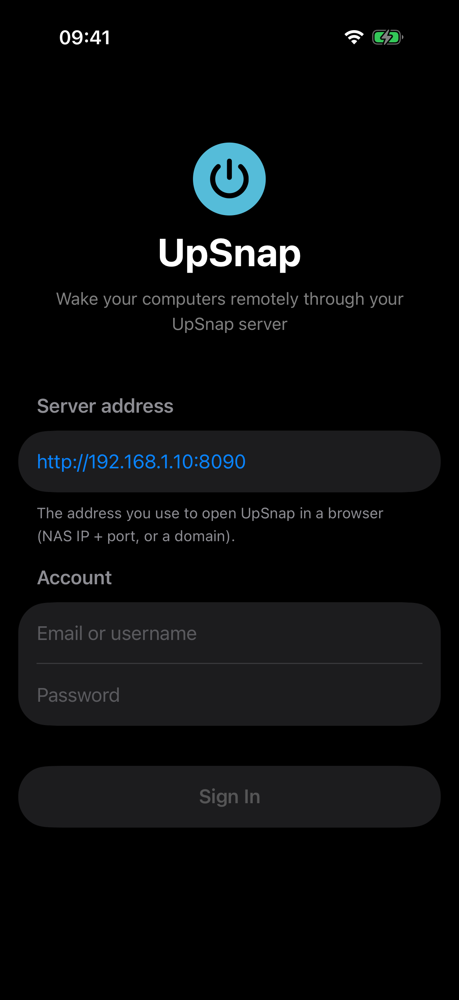
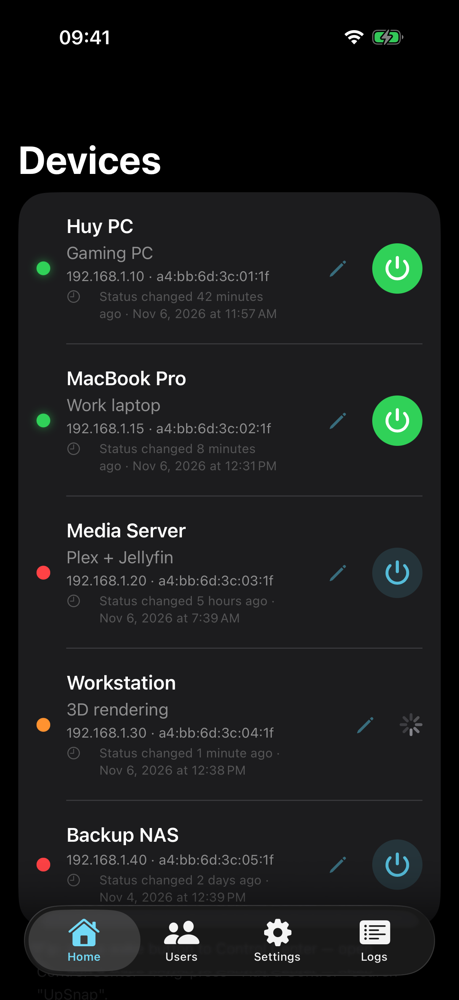
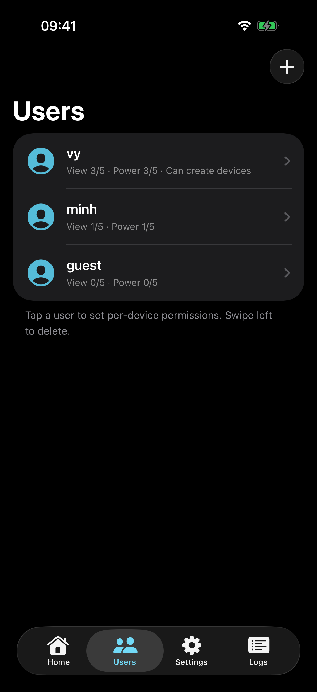
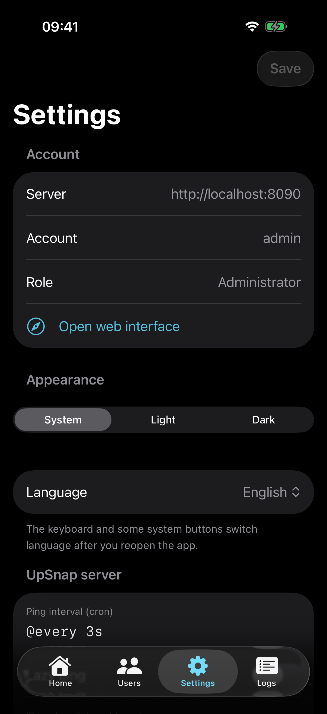
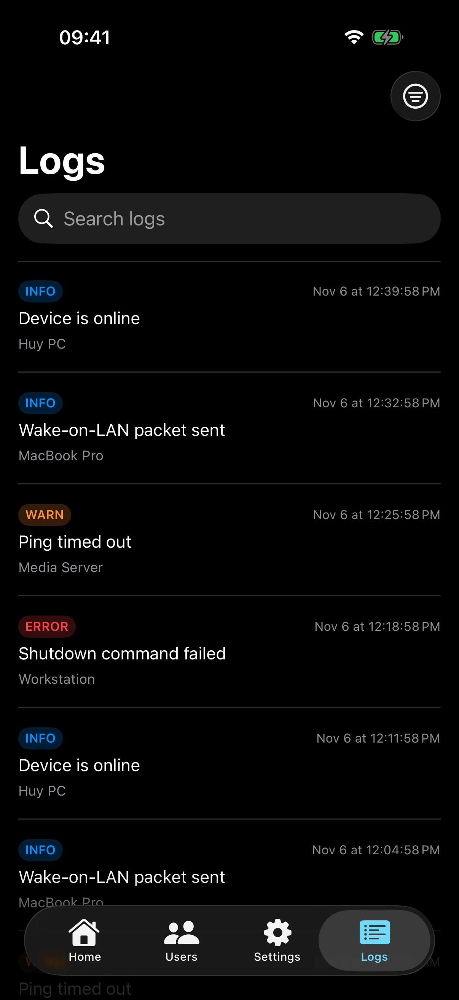
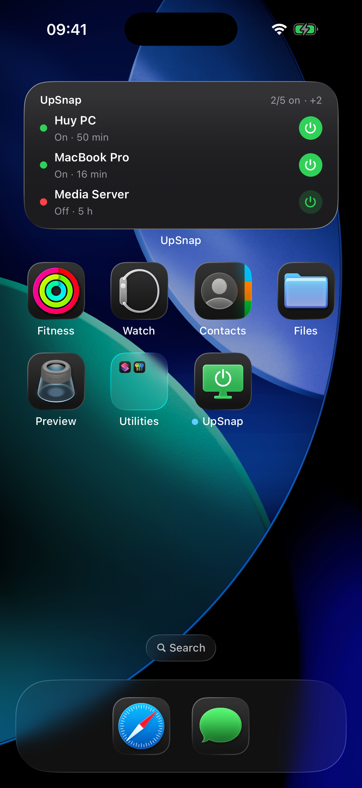
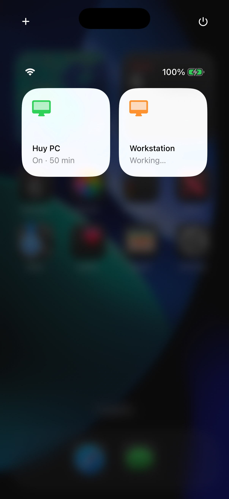

# UpSnap for iOS

A native iOS client for [UpSnap](https://github.com/seriousm4x/upsnap), the self-hosted Wake-on-LAN dashboard.
See which computers are on, wake them up remotely, and put a **wake button in Control Center**, on your
Home Screen or on the Lock Screen.

> Unofficial app, not affiliated with the UpSnap project. You need your own UpSnap server.

## Screenshots

| Sign in | Devices | Users | Settings | Logs |
|:-:|:-:|:-:|:-:|:-:|
|  |  |  |  |  |

| Home Screen widget | Control Center |
|:-:|:-:|
|  |  |

## Features

- **Sign in** with your UpSnap account (admin or regular user), just like the web UI. Stays signed in.
- **Devices**: live online/offline status (refreshed every 3 seconds), description and "status changed … ago".
- **Power**: wake (Wake-on-LAN), plus shut down / reboot / sleep when configured in UpSnap.
- **Edit devices**: name, IP, MAC, wake/shutdown cron schedules, custom commands, delete.
- **Users** (admin only): create and delete users, set View / Edit / Delete / Power permissions per device.
- **Server settings** (admin only): ping interval, lazy ping, website title.
- **Logs** (admin only): filter by level, search, UpSnap-only logs.
- **Control Center** controls, also usable on the Lock Screen and the Action button:
  - *Wake Computer*: a button that sends Wake-on-LAN. Never shuts down by accident.
  - *Computer Switch*: a toggle that turns green when the computer is on. On = wake, off = shut down.
  - Both show the status and how long ago it changed, e.g. "On · 42 min".
- **Widgets**: small (one computer), medium and large (all computers), plus Lock Screen widgets,
  each with a quick wake button.
- **Siri & Shortcuts**: "Wake Computer" and "Shut Down Computer" actions.
- Tab bar with Liquid Glass on iOS 26.
- Light / Dark / System appearance; English / Vietnamese / System language.

## Requirements

- iPhone or iPad with **iOS 18** or later (Control Center controls need iOS 18).
- An UpSnap server reachable from your phone. Outside your home network, use a VPN
  (Tailscale, WireGuard…) or a public domain.
- To build: a Mac with **Xcode 16** or later (developed with Xcode 26).

## Install

### Option 1: Xcode (recommended)

1. Open `UpSnap.xcodeproj`.
2. Select the **UpSnap** target › Signing & Capabilities › choose your Team (a free personal Apple ID works).
   Do the same for the **UpSnapWidgets** target.
3. If Xcode reports that the bundle ID is taken, change `com.huy.upsnap` to your own ID in **both targets**
   (the widget must be `<app-id>.widgets`). Then change the App Group `group.com.huy.upsnap` in
   `Config/*.entitlements` and in `Shared/AppConfig.swift` to match.
4. Connect your iPhone, select it as the run destination and press Run.

> With a free Apple ID the app expires after 7 days; run it again from Xcode to renew.

### Option 2: IPA (Sideloadly / AltStore)

```sh
./build_ipa.sh        # builds an unsigned build/UpSnap.ipa
```

Then drag `build/UpSnap.ipa` into Sideloadly (or AltStore) to sign and install it.

## Getting started

1. Open the app and enter your server address, the same one you use in the browser,
   e.g. `http://192.168.1.10:8090`.
2. Sign in with your UpSnap email/username and password.
3. Allow **Local Network** access when iOS asks.

### Add a control to Control Center

Open Control Center › long-press an empty area › **Add a Control** › search **UpSnap** ›
pick *Wake Computer* or *Computer Switch* › tap the new control to choose a computer.

### Add a widget

Long-press the Home Screen › **Edit** › **Add Widget** › **UpSnap**. For the single-computer widget,
long-press it › **Edit Widget** to choose a computer.

## Project structure

| Folder | Contents |
|---|---|
| `Shared/` | UpSnap / PocketBase API client, credential storage (Keychain + App Group), App Intents, translations (`Localizable.xcstrings`) |
| `UpSnap/` | SwiftUI app: devices, device editor, users, settings, logs |
| `UpSnapWidgets/` | Control Center controls and Home Screen / Lock Screen widgets |
| `Tools/` | App icon generator (`make_icons.sh`) |
| `Config/` | Info.plist and entitlements |

## How it talks to UpSnap

The app uses the same API as the UpSnap web UI:

- Sign in: `POST /api/collections/_superusers/auth-with-password`, falling back to `users`
- Devices: `GET /api/collections/devices/records`
- Power: `GET /api/upsnap/{wake|shutdown|sleep|reboot}/{id}?async=true`

Your password is stored in the iOS Keychain. The session token is shared with the widgets through an App Group,
and the app renews it each time you open it.
